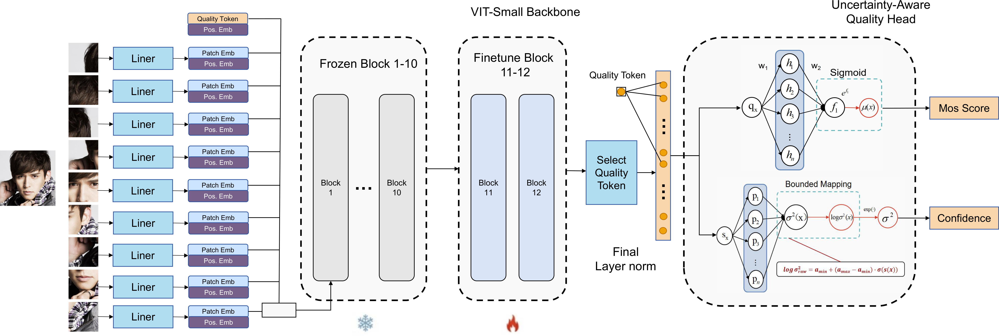

# ViT-FIQA-Uncertainty

[](https://creativecommons.org/licenses/by-nc/4.0/)

Official implementation of *uncertainty-aware Face Image Quality Assessment (FIQA)* built on top of [ViT-FIQA](https://github.com/jankolf/ViT-FIQA).

**Uncertainty-Aware Face Image Quality Assessment via Heteroscedastic Gaussian Modeling and Parameter-Efficient Fine-Tuning**

**Jiateng Guo** <sup>a</sup>, **Keyu Zhu** <sup>a</sup>, **Meilan Jiang** <sup>b,*</sup>

<sup>a</sup> International College, Chongqing University of Posts and Telecommunications, Chongqing 400065, China  
<sup>b</sup> School of Software Engineering, Chongqing University of Posts and Telecommunications, Chongqing 400065, China

*Submitted to **Displays**.*

## Overview



*Figure 1: Block diagram of the proposed network.*

This codebase studies **whether a face image quality prediction can be paired with a reliable, sample-dependent uncertainty estimate**. It trains a Vision Transformer backbone (the FR-pretrained ViT from ViT-FIQA) with three quality-prediction variants under identical data, seeds, initialization and fine-tuning scope, and evaluates both **predictive accuracy** and **uncertainty calibration / selective prediction** through a single, fully reproducible pipeline.

---

## Highlights

- **One-command reproducibility.** `python run_all_experiments.py --profile standard` runs the whole paper protocol: 12 trainings (3 seeds × 3 main methods, plus sanity and fine-tuning-scope controls), all offline analyses, statistical tests, and figures — each run writes into a timestamped `outcome/` directory.
- **Controlled comparison.** MSE, homoscedastic NLL and heteroscedastic NLL share the same data splits, seeds, mean-head initialization, and Top-2 fine-tuning range, so differences are attributable to the modeling choice, not the setup.
- **No data leakage by construction.** Train/val/test overlap is checked byte-wise (SHA-256) before any training starts.
- **Full uncertainty evaluation:** SRCC/PLCC/MAE/RMSE/Gaussian NLL, variance–|error| correlation, 5-bin calibration (MAE/RMSE/RMV-RMSE), rejection curves vs. random and oracle baselines, prediction-interval coverage, ENCE / AURC / AUSE, standardized residuals, paired Wilcoxon tests with Bootstrap 95% CIs, and a parameter–performance study over fine-tuning scopes.
- **Interpretability & robustness:** true QS-token attention maps from the last Transformer block, controlled-degradation sensitivity (blur / brightness / downsampling / JPEG), and an optional out-of-distribution study on LFW.

## Experiments

| Category | Experiment | Seeds | Purpose |
|---|---|---|---|
| Main | Single-output MSE | 3 | Deterministic baseline |
| Main | Global learnable variance (NLL) | 3 | Homoscedastic probabilistic baseline |
| Main | Input-dependent heteroscedastic variance (NLL) | 3 | **Proposed method** |
| Sanity | Dual output trained with mean-MSE only | 1 | Shows the variance head receives no gradient when it is not in the loss |
| Scope | Heteroscedastic NLL, head-only | 1 | Parameter-efficiency comparison |
| Scope | Heteroscedastic NLL, full | 1 | Full vs. Top-2 quality-prediction path |

> "Full" updates patch embeddings, position/quality tokens, all 12 Transformer blocks, the final norm and the quality head; the FR feature head (not used by this study) stays frozen so irrelevant parameters are excluded from the count. The Top-2 main experiments also serve as the Top-2 point in the scope study, so nothing is retrained twice.

## Requirements

- Python **≥ 3.8** with PyTorch + CUDA (the original ViT-FIQA environment is sufficient).
- Install the dependencies:

```bash
pip install -r requirements_paper_experiments.txt
```

**Do not** upgrade PyTorch/CUDA just for this codebase if your existing ViT-FIQA environment works.

## Data preparation

Place the dataset so that each split directory contains a `labels.csv` and an `img/` folder:

```text
ViT-FIQA-Uncertainty/
├─ data/
│  ├─ train/
│  │  ├─ labels.csv
│  │  └─ img/                 # the training face images
│  ├─ val/
│  │  ├─ labels.csv
│  │  └─ img/
│  └─ test/
│     ├─ labels.csv
│     └─ img/
├─ pretrained_weights/
│  └─ model.pt                # FR-pretrained ViT backbone with quality head
└─ outcome/                   # created automatically at runtime
```

`labels.csv` format: the first two columns are the image file name and its MOS score. The header names are ignored (only positions matter). Example:

```text
image_name,mos
000001.jpg,0.83
000002.jpg,0.64
```

The pipeline validates that every referenced image exists, that MOS is finite, that there are no duplicate file names, and that **no file with the same relative name and identical bytes appears in more than one split** (train/val/test leakage check).

## Pretrained weights

Download the pre-trained ViT-FIQA model weights and place them at `pretrained_weights/model.pt`:

- [ViT-FIQA model weights](https://drive.google.com/drive/u/0/folders/1CZVZnZbnoNaxk_xHhIHU5yLRi7Iqa1jP) (official ViT-FIQA repository)

If your file is located elsewhere, edit only `experiment_config.json` → `paths`; do **not** modify the Python code.

## Quick start

### 1. Smoke test (recommended, ~1 epoch on 16 samples per split)

```bash
smoke_test_first.bat          # Windows
# or
python run_all_experiments.py --profile core --smoke-test
```

The smoke test verifies data paths, CSV↔image consistency, pretrained-weight loading, mean-head initialization, Top-2 freeze scope, gradients of the mean / global-variance / per-sample-variance outputs, and the checkpoint/CSV/plot pipeline. Only when `PIPELINE_COMPLETED.json` appears should you run the full protocol.

### 2. Full protocol (paper results)

```bash
run_all_experiments.bat       # Windows, standard profile
# or
python run_all_experiments.py --profile standard
```

### Profiles

| Profile | Content |
|---|---|
| `core` | 3 one-seed models (fast iteration) |
| `standard` | 3×3 seeds for main methods + sanity + head-only/full scope controls (paper results, ~12 runs) |
| `extended` | `standard` + Top-1/Top-4 scope points |

### Useful flags

```bash
python run_all_experiments.py --profile standard --check-only   # validate paths/data/model only
python run_all_experiments.py --profile standard --dry-run      # print + save the run plan, run nothing
python run_all_experiments.py --profile standard --resume PATH  # resume an interrupted run dir
```

`--resume` skips already-completed experiments (each training writes a `completed.json`); you must reuse the same profile and config.

## Configuration

Everything tunable lives in `experiment_config.json` (data paths, seeds, epochs, early stopping, batch size, LR schedule, model hyper-parameters, analysis options). All paths are **relative to the repository root**. If you only need to point the code at your data/weights, edit the `paths` block.

Running out of GPU memory? Lower `training.batch_size` (e.g. 64 → 32 → 16) in the config and re-run the smoke test. Keep the same batch size across the three main experiments; do **not** change model structure, image size, freeze scope, or losses.

## Outputs

Every run creates a timestamped directory, e.g. `outcome\FIQA_PAPER_20260731_153000\`:

```text
├─ pipeline.log                       full-pipeline log
├─ dataset_validation.json            split stats + leakage check
├─ experiment_plan.json               actual run list
├─ resolved_config.json               config snapshot
├─ system_info.json                   PyTorch / CUDA / GPU info
├─ source_snapshot\                   copy of the code used for this run
├─ runs\<one dir per experiment>\
│  ├─ best_model.pt
│  ├─ completed.json
│  ├─ parameter_audit.json / gradient_audit.json
│  ├─ training_history.csv / test_predictions.csv
│  ├─ training_curves.png / prediction_vs_mos.png
│  └─ uncertainty_dashboard.png / uncertainty_calibration.png
├─ all_runs_summary.csv
├─ main_experiments_mean_std.csv      ← paper primary table (3-seed mean ± std)
├─ paired_statistical_tests.csv
├─ finetune_scope_results.csv
├─ manuscript_results_summary.md
├─ main_model_comparison.png / finetune_efficiency.png / true_qs_attention_comparison.png
└─ external_analysis\  (controlled degradation; LFW if available)
```

The run is complete only when `PIPELINE_COMPLETED.json` exists at the run root. If it fails, read `PIPELINE_FAILED.json` and `pipeline.log` first — they state the exact file path, exception type and stack trace.

## FAQ / notes for reviewers

- Paper numbers must be read from `main_experiments_mean_std.csv` only; single-seed results are for debugging.
- LFW has no MOS labels, so it is used as a descriptive out-of-distribution study only; controlled degradation is a sensitivity check and does **not** replace the official test metric.
- Attention maps come from the real QS-token attention of the last Transformer layer — there is no random-tensor fallback. Attention visualization is interpretability evidence, not a standalone performance claim.

## Citation

If you find this work useful, please cite:

```bibtex
@article{guo2026uncertainty,
    author  = {Guo, Jiateng and Zhu, Keyu and Jiang, Meilan},
    title   = {Uncertainty-Aware Face Image Quality Assessment via Heteroscedastic Gaussian Modeling and Parameter-Efficient Fine-Tuning},
    journal = {Displays},
    year    = {2026},
    note    = {Under review}
}
```

And the base method:

```bibtex
@InProceedings{Atzori_2025_ICCV,
    author    = {Atzori, Andrea and Boutros, Fadi and Damer, Naser},
    title     = {ViT-FIQA: Assessing Face Image Quality using Vision Transformers},
    booktitle = {Proceedings of the IEEE/CVF International Conference on Computer Vision (ICCV) Workshops},
    month     = {October},
    year      = {2025},
    pages     = {5935-5945}
}
```

## Acknowledgements

This work is based on [ViT-FIQA](https://github.com/jankolf/ViT-FIQA), which in turn builds on [InsightFace](https://github.com/deepinsight/insightface/tree/master/recognition/arcface_torch) and [CR-FIQA](https://github.com/fdbtrs/CR-FIQA).

## License

This project is released under the [Attribution-NonCommercial 4.0 International (CC BY-NC 4.0)](https://creativecommons.org/licenses/by-nc/4.0/) license, consistent with the ViT-FIQA code it derives from. See `LICENSE` for details.

Copyright (c) 2026 Jiateng Guo, Keyu Zhu, Meilan Jiang.
